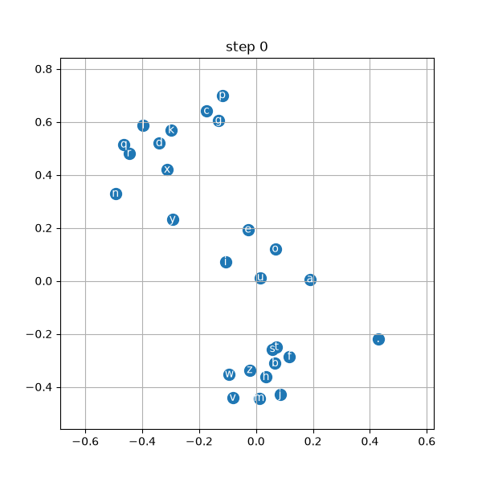

# nn-zero-to-hero-annotated

My annotated walkthrough of Andrej Karpathy's [Neural Networks: Zero to Hero](https://karpathy.ai/zero-to-hero.html) series, with explanatory comments, extra visualizations, and small experiments for each lecture.

> **Credit:** The original code and lectures belong to [Andrej Karpathy](https://github.com/karpathy). This repo is my personal interpretation of his material. I coded along with the videos and added my own comments, plots and experiments on top.

## Highlight

How the 2D character embeddings move during training (MLP lecture):

## Lectures

| # | Lecture | Folder | My additions |
|---|---------|--------|--------------|
| 01 | micrograd | coming soon | |
| 02 | makemore: bigram | coming soon | |
| 03 | makemore: MLP | [03-makemore-mlp](03-makemore-mlp) | Embedding training animation (GIF), forced neuron activation experiment, step-by-step comments on embeddings, one-hot and `.view` |
| 04 | makemore: activations & BatchNorm | coming soon | |
| 05 | makemore: backprop ninja | coming soon | |
| 06 | makemore: WaveNet | coming soon | |
| 07 | GPT from scratch | coming soon | |
| 08 | GPT tokenizer | coming soon | |

## Setup

pip install torch matplotlib jupyter

## License

MIT. See [LICENSE](LICENSE). Original copyright © Andrej Karpathy.